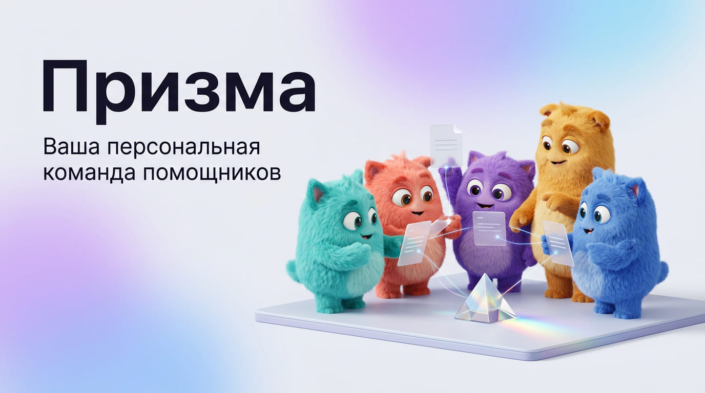

# Prism

<p align="center">
  
</p>

**Diploma project** — a personal research assistant over a private knowledge base.

Prism combines a transparent **RAG** pipeline with a **multi-agent** orchestration layer. You upload documents and links, ask a question or set a research goal, and the system retrieves evidence, optionally delegates specialist agents, and returns an answer with citations. Every stage is measurable: retrieval quality, generation faithfulness, latency, and cost.

Author: **Andrei Lomakin**. License: **MIT**.

---

## Motivation

Most “chat with your docs” demos hide the retrieval stack behind opaque frameworks. For an ML diploma that is the wrong trade-off: the interesting part is *which* chunking, embedding, search, reranking, and rewriting choices actually move quality — and by how much.

Prism keeps the ML core explicit and ablatable. The web UI and API stay deliberately thin so effort stays on retrieval science, evaluation, and agent control rather than product chrome.

---

## What you get

| Layer | Role |
|---|---|
| **Ingest** | PDF, DOCX, Markdown, TXT, HTML, URL → normalized text → chunks |
| **RAG** | Pluggable chunking, embeddings, dense / lexical / hybrid search, reranker, query rewriting, grounded generation with citation checks |
| **Eval** | Golden dataset, retrieval & generation metrics, ablation reports (quality × latency × $), git provenance in every report |
| **Agents** | Orchestrator + Retriever / Web / Analyst / Critic. Fail-closed ActionGate, per-run budgets, checkpointed resume, approvals inside the chat turn |
| **Ops** | Docker Compose (API, worker, Postgres+pgvector, Redis), Ollama or OpenAI-compatible APIs |

---

## Quick start

```bash
cp .env.example .env
docker compose up -d --build
pip install -e ".[dev]"   # or: just install
just demo                 # init-db + ingest-demo + rebuild-bm25
```

Open **http://127.0.0.1:8000**. Compose publishes the API and Postgres on loopback only (`127.0.0.1:8000`, `127.0.0.1:5434`).

Containers load [`.env.example`](.env.example). Generation expects Ollama on the host at port `11434`. `docker compose --profile local-llm up` starts Ollama inside the stack instead. Optional HTTP Basic: put `AUTH_PASSWORD` in `.env` before `docker compose up` (Compose interpolates it; `/api/health` stays open).

The UI is Chat (plain answer or agent), Search, Knowledge base, Journal, Eval, and Settings. An agent action that needs permission shows **Approve** / **Deny** on that message. There is no separate approvals screen.

---

## Reproduce (defense)

```bash
just check              # fmt + lint + pytest
just defense-prep       # check + provenance + ablation table + agent eval
# with DB up + indexed corpus:
just defense-test-eval  # held-out hybrid + dense on test.jsonl
```

Every eval report under `reports/<run_id>/` includes:

- `metrics.json` / `summary.md` / `per_question.jsonl`
- **`provenance.commit`** (git SHA, branch, dirty flag)

```bash
prism eval provenance
prism eval compare      # → reports/ABLATION_TABLE.md + ABLATION_RECALL.svg
prism eval kappa --a data/golden/annotator_a.example.jsonl --b data/golden/annotator_b.example.jsonl
```

The retrieval numbers from that held-out set are in the table below.

---

## Architecture (high level)

```
UI (Jinja) ──► FastAPI
                 │
                 ├─► Postgres + pgvector   (documents, chunks, vectors, runs, memory)
                 ├─► BM25 index on disk    (lexical / hybrid)
                 ├─► Redis + arq worker    (ingest jobs)
                 ├─► LLMGateway            (Ollama | OpenAI-compatible)
                 └─► Embeddings / reranker (local sentence-transformers / cross-encoder)
```

Design rules: one interface per concern · fail-closed tool policy · grounded `[n]` answers · measure, don’t assert.

### Agent control

ActionGate defaults to ask. An unknown tool waits. Knowledge-base search, query rewrite, citation checks, and subagent spawn are allowed through. `web_search`, `fetch_page`, the Python sandbox, and memory rollback wait for an explicit decision.

The decision is two buttons on the agent message. Approving continues the **same run**: same id, retrieved chunks, budget, and step history. Time spent waiting on the user is excluded from the active-time budget. Search and page fetch are separate approvals. A second click on an approval that already ran does not execute the tool again. If the approved tool raises, the run is marked failed and is not retried. If synthesis fails after a successful tool, the tool output stays on the checkpoint and only synthesis is repeated.

Compose ships with `WEB_SEARCH_MOCK=false` (see `.env.example`): live search goes to DuckDuckGo lite. A timeout, an HTTP error, or an empty parse comes back as an empty result list and an explicit status. The answer can still use the knowledge-base hits, and it says that external data is missing. With the variable unset, the application default is mock mode, and those snippets are labeled as test data.

URL ingest and `fetch_page` share one fetcher. It allows HTTP(S) only, rejects credentials in the URL, and blocks loopback, private, link-local, and metadata addresses, including IPv4-mapped IPv6. Each redirect is checked before the next request. The address validated for that hop is the address the socket connects to. An approval does not skip this check. The pin is local to the process for that one request.

Approvals sit in memory inside the API process (`APPROVAL_TTL_SECONDS`, default 300). The workflow is checkpointed and role-based (retriever, web, analyst, critic). It follows that fixed path rather than inventing new tool sequences on its own.

---

## Eval snapshot (dev, same 39 answerable Qs)

| | Dense | Hybrid RRF |
|---|---:|---:|
| Recall@5 | 0.590 | **0.808** |
| MRR@10 | 0.355 | **0.695** |
| nDCG@10 | 0.407 | **0.695** |
| Hit@5 | 0.667 | **0.949** |

Paired Δ Recall@5 = +0.218 (95% CI 0.115–0.321, P(Δ>0)=1.0).

Default chat model: `qwen2.5:1.5b` (Ollama; light default for weak GPUs — swap via Settings / `LLM_MODEL`). Embedder: `paraphrase-multilingual-MiniLM-L12-v2`. Postgres host port **5434**.

---

## Lint / format / test

Requires [just](https://github.com/casey/just).

```bash
just check / just fix / just test / just lint / just fmt
```

---

## Attribution / third-party

| Component | License / note |
|---|---|
| Demo corpus (`data/demo/corpus/`) | Original MIT educational notes for this diploma |
| `sentence-transformers` / MiniLM | Apache-2.0 (Hugging Face model cards) |
| `bm25s`, FastAPI, SQLAlchemy, pgvector | respective OSS licenses |
| Ollama models (e.g. qwen2.5) | follow model card terms |

No scraped copyrighted books/articles in the committed corpus.

## License

MIT — see [LICENSE](LICENSE).
